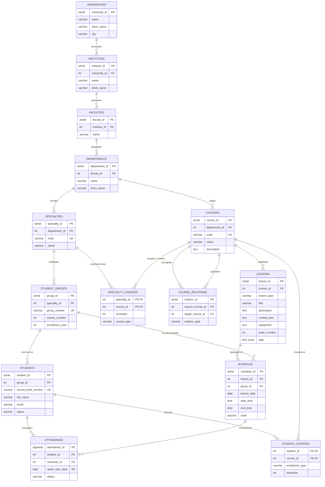
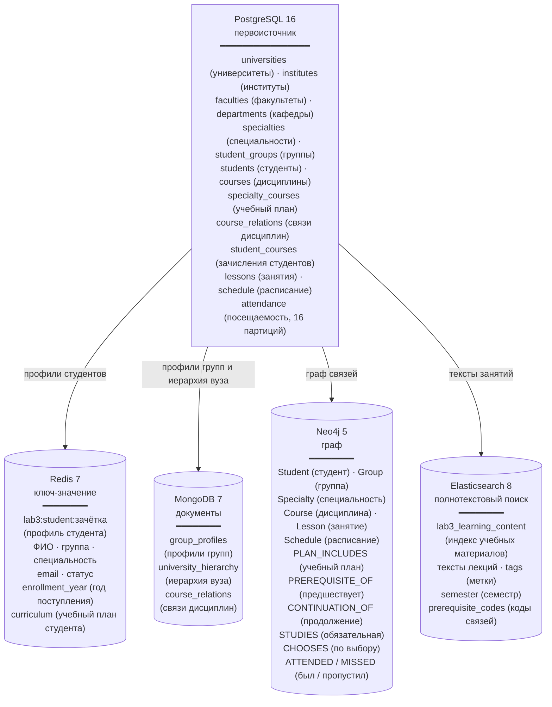

# ER-диаграмма и размещение данных по хранилищам

Практическая работа № 3. Полиглотное хранилище «Университет»:
PostgreSQL 16 (первоисточник) + Redis 7 + MongoDB 7 + Neo4j 5 + Elasticsearch 8.

---

## 1. ER-диаграмма PostgreSQL (актуальная структура, после миграции)

> Диаграмма в формате Mermaid — рендерится в GitHub/GitLab, VS Code (плагин Mermaid), Typora.

### Ключевые ограничения (не видны на диаграмме напрямую)

| Таблица | Ограничение | Смысл |
|---|---|---|
| `specialty_courses` | PK (`specialty_id`, `course_id`) | M:N, одна дисциплина в нескольких планах |
| `specialty_courses` | CHECK `semester > 0`, CHECK `course_type IN ('mandatory','elective')` | корректность учебного плана |
| `course_relations` | CHECK `source <> target` | запрет связи дисциплины с собой |
| `course_relations` | UNIQUE (`source`, `target`, `relation_type`) | запрет дублей связей |
| `student_groups` | CHECK `enrollment_year + course_number = 2026` | согласованность курса и года поступления |
| `student_courses` | триггер `trg_student_courses_enrollment_type` | тип зачисления = тип дисциплины в плане специальности |
| `attendance` | PARTITION BY RANGE (`week_start_date`), PK (`attendance_id`, `week_start_date`) | 16 недельных партиций семестра |

---

## 2. Таблица размещения данных по БД (Polyglot Persistence)

| Данные | PostgreSQL (первоисточник) | Redis 7 (кэш) | MongoDB 7 (документы) | Neo4j 5 (граф) | Elasticsearch 8 (поиск) |
|---|---|---|---|---|---|
| Университет, институты, факультеты, кафедры | 4 нормализованные таблицы | — | `university_hierarchy` — один документ всей иерархии | — | — |
| Специальности | `specialties` | поле `specialty` в хэше студента | объект `specialty` в профиле группы | узлы `Specialty` | поле `specialty_codes` в документах занятий |
| Группы | `student_groups` (+ `enrollment_year`, `course_number`) | поле `group` | корень `group_profiles` + объекты групп в иерархии | узлы `Group` (+ `enrollment_year`) | — |
| Студенты (1000) | `students` | **ключ** `lab3:student:<зачётка>` → hash: ФИО, группа, специальность, кафедра, email, статус, `enrollment_year`, `curriculum` | массив `students[]` внутри профиля группы | узлы `Student` | — |
| Дисциплины | `courses` (+ `description`) | — | массив `courses[]` с description в профиле группы | узлы `Course` (+ description) | поля `course_code`, `course_name` |
| Учебный план (M:N специальность↔дисциплина) | `specialty_courses` (20 строк: semester, course_type) | поле `curriculum` (персональный план студента) | `plan` в SPECIALTIES → курсы с `semester` и `type` в профилях групп | рёбра `PLAN_INCLUDES {semester, course_type}` (20) | поле `semester` в документах занятий |
| Связи дисциплин (8: prerequisite/related/continuation) | `course_relations` | — | коллекция `course_relations` | рёбра `PREREQUISITE_OF` (4), `CONTINUATION_OF` (2), `RELATED_TO` (2) | поля `prerequisite_codes`, `continuation_codes`, `related_codes` (21 документ) |
| Зачисления студентов (2636) | `student_courses` (enrollment_type, semester) | — | — | рёбра `STUDIES` (1884) и `CHOOSES` (752) | — |
| Занятия (30) | `lessons` (тип, содержание, оборудование, теги) | — | массив `lessons[]` в профиле группы | узлы `Lesson`, рёбра `HAS_LESSON` | **основное хранилище**: индекс `lab3_learning_content` (тексты лекций + метаданные) |
| Расписание (204) | `schedule` | — | — | узлы `Schedule` | — |
| Посещаемость (6000) | `attendance` — 16 недельных RANGE-партиций | — | — | рёбра `ATTENDED` (5110) / `MISSED` (890) | — |

### Обоснование выбора хранилищ

| Хранилище | Тип | Почему именно оно |
|---|---|---|
| PostgreSQL 16 | реляционное, транзакционное | Нормализованная модель, внешние ключи, CHECK-ограничения, триггеры — гарантии целостности; партиционирование посещаемости для диапазонных запросов по неделям |
| Redis 7 | ключ-значение | Чтение профиля студента по номеру зачётки за O(1); кэш «горячих» данных без соединений |
| MongoDB 7 | документное | Профиль группы и иерархия вуза — композиция: один документ вместо 5 JOIN; учебный план вложен в профиль |
| Neo4j 5 | граф | Поиск связей в глубину: «у кого из студентов общий обязательный курс», цепочки prerequisites — обход рёбер вместо рекурсивных SQL |
| Elasticsearch 8 | полнотекстовый поиск | Русская морфология (analyzer `russian`) по текстам лекций; метаданные (тип занятия, теги, семестр, связи) — фильтрация фасетами |

### Хранилища и данные в них

| Хранилище | Данные | Объекты |
|---|---|---|
| PostgreSQL 16 | Вся нормализованная модель: иерархия вуза, специальности, группы, студенты, дисциплины, учебный план, связи дисциплин, зачисления, занятия, расписание, посещаемость | 15 таблиц, FK, CHECK, триггер, RANGE-партиции |
| Redis 7 | Профили студентов для доступа за O(1): ФИО, группа, специальность, кафедра, email, статус, год поступления, персональный учебный план | Ключи lab3:student:зачётка — hash |
| MongoDB 7 | Профили групп: специальность, год поступления, студенты, план с семестрами и типами, занятия; иерархия вуза одним документом; связи дисциплин | Коллекции group_profiles, university_hierarchy, course_relations |
| Neo4j 5 | Узлы студентов, групп, специальностей, курсов, занятий, расписания и рёбра членства, зачислений, учебного плана, связей курсов, посещаемости | MEMBER_OF, BELONGS_TO, STUDIES, CHOOSES, PLAN_INCLUDES, PREREQUISITE_OF, CONTINUATION_OF, RELATED_TO, HAS_LESSON, ATTENDED, MISSED |
| Elasticsearch 8 | Тексты занятий для полнотекстового поиска и метаданные: курс, тип занятия, теги, специальности, семестр, коды связанных дисциплин | Индекс lab3_learning_content, analyzer russian |
